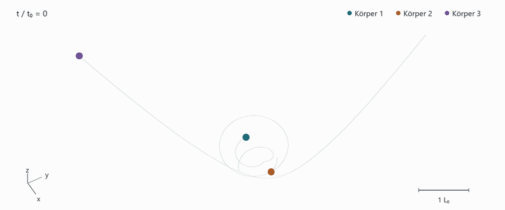
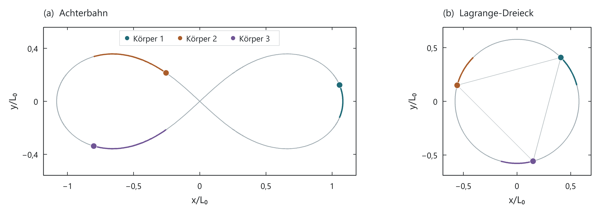
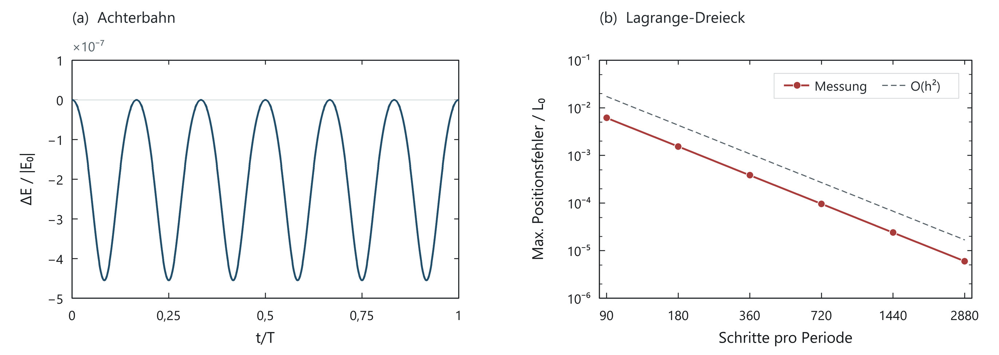
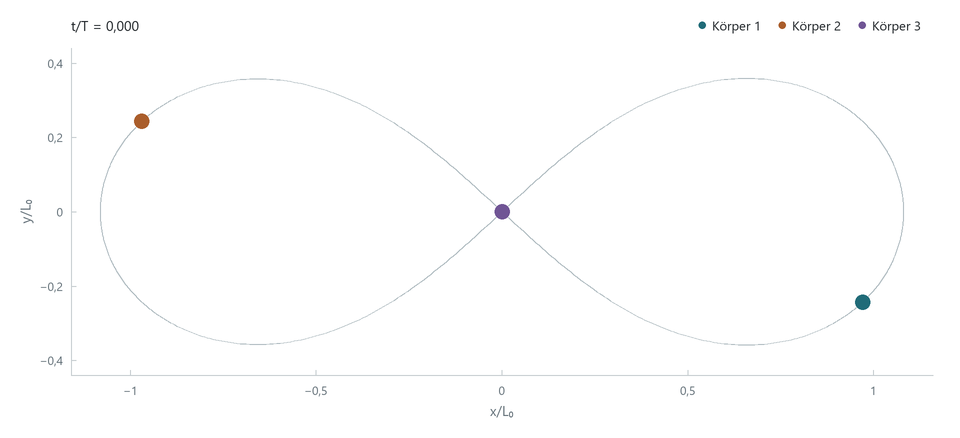
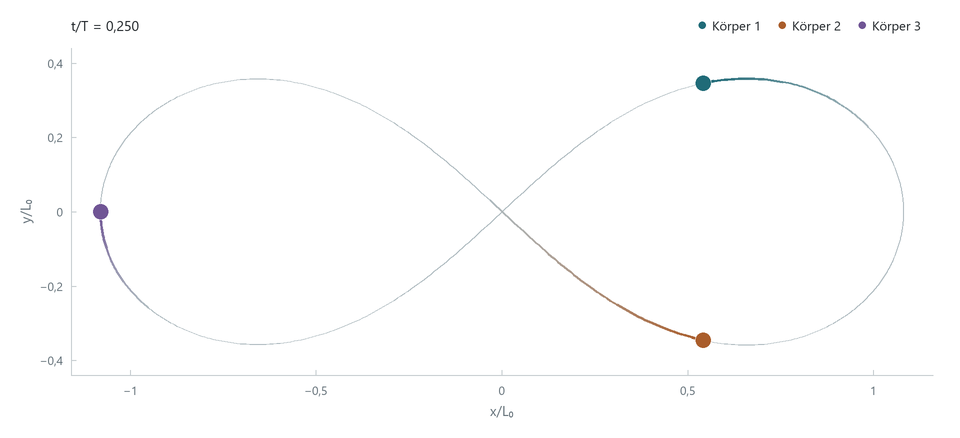

# Das Dreikörperproblem in 3D

Drei Punktmassen, drei Startorte und drei Anfangsgeschwindigkeiten. Im Browser kannst du alle Werte ändern, eine Bahn berechnen und die Ansicht mit der Maus oder dem Finger drehen. Der gezeigte Vorbeiflug hat die Massen 1, 0,7 und 0,18.



**[Interaktive 3D-Simulation herunterladen](https://github.com/chabane95/three-body-problem/raw/refs/heads/main/downloads/Dreikoerperproblem.zip)** · ZIP entpacken und `Dreikoerperproblem.html` in einem aktuellen Browser öffnen. Auch eigene Bahnen werden offline berechnet. Unter **Anfangsdaten bearbeiten** kannst du Massen, Positionen, Geschwindigkeiten und Laufdauer vorgeben. Die Messdaten lassen sich unter der Animation aufklappen.

## Theorie

Für drei positive Punktmassen mit Ortsvektoren $\mathbf r_i=(x_i,y_i,z_i)$ gilt das Newtonsche Gravitationsgesetz

$$
\ddot{\mathbf r}_i =
G\sum_{j\ne i}m_j
\frac{\mathbf r_j-\mathbf r_i}{\lVert\mathbf r_j-\mathbf r_i\rVert^3}.
$$

Im Browser ist $G=1$. Längen, Massen und Zeiten sind in Einheiten von $L_0$, $M_0$ und $t_0=\sqrt{L_0^3/(G_\mathrm{phys}M_0)}$ angegeben. Der räumliche Vorbeiflug und eigene Anfangswerte laufen bis zur gewählten Endzeit. Zwei periodische Bahnen mit gleichen Massen dienen als Referenz.

**Die Acht.** Nach einem Drittel der Periode erreicht jeder Körper den Startplatz seines Vorgängers. Für die Rechnung verwende ich die Anfangswerte von Carles Simó und die Periodenschätzung $T=6.32591398$ aus Abbildung 1 bei Chenciner und Montgomery. [Originalarbeit mit Anfangswerten](https://perso.imcce.fr/alain-chenciner/huit.pdf)

**Das Dreieck.** Drei Massen an den Ecken eines gleichseitigen Dreiecks der Seitenlänge 1 erfahren im Schwerpunktssystem die Beschleunigung $\ddot{\mathbf r}_i=-3\mathbf r_i$. Mit der passenden tangentialen Anfangsgeschwindigkeit rotieren sie auf einem Kreis mit Radius $1/\sqrt{3}$ und Winkelgeschwindigkeit $\sqrt{3}$. Diese exakte Lösung nutze ich, um den Integrator zu prüfen.

[](assets/trajectories.svg)

Das gleiche Kraftgesetz beschreibt auch Begegnungen dreier Sterne, bei denen ein Doppelstern zurückbleiben und der dritte Stern entkommen kann. Eine Anwendung des eingeschränkten Dreikörperproblems ist die Bewegung von Raumsonden nahe dem Sonne-Erde-Punkt L2. [Dreifachbegegnungen](https://www.nature.com/articles/s41586-019-1833-8) · [Webbs Umlaufbahn](https://esawebb.org/about/general/orbit/)

## Numerische Umsetzung

**Eigene 3D-Bahnen.** Derselbe C++17-Kern läuft nativ und als WebAssembly im Browser. Dormand–Prince 5(4) schätzt den lokalen Fehler aus zwei Näherungen verschiedener Ordnung. Überschreitet der geschätzte Fehler einer relativen Position oder Geschwindigkeit die Toleranz, verwirft der Integrator den Schritt und versucht einen kleineren. Paarabstand, Relativgeschwindigkeit und gravitative Fallzeit begrenzen die Schrittweite zusätzlich. Die Animation zeigt 721 gleichmäßig verteilte Zeitpunkte. Wie viele interne Schritte dazwischen nötig sind, bestimmt der Integrator. Pro Lauf sind bis zu 250 000 Schrittversuche vorgesehen. [Dormand & Prince](https://doi.org/10.1016/0771-050X(80)90013-3)

In einem Test schrumpft eine geneigte, exzentrische Lagrange-Konfiguration von Seitenlänge 1,98 auf 0,02. Am engsten Punkt beträgt der größte Positionsfehler $7.54\times10^{-6}$ bei relativer Toleranz $10^{-5}$ und $1.48\times10^{-10}$ bei $10^{-10}$ (absolute Toleranzen jeweils um Faktor 1 000 kleiner). Die Toleranz steuert den Fehler je Schritt. Bei chaotischen Bahnen können sich Abweichungen über lange Zeiten verstärken.

Ein einstellbarer Abbruchabstand stoppt enge Passagen. Der Kern prüft auch Annäherungsminima zwischen akzeptierten Schritten. Bei einer Punktkollision ist die Newtonsche Kraft singulär. Ein solcher Lauf oder eine rechnerisch nicht mehr auflösbare Begegnung endet mit einer Meldung.

**Periodische Referenzbahnen.** Für die gespeicherten Abbildungen der Acht und des kreisförmigen Dreiecks verwende ich Velocity-Verlet mit **7 200 festen Schritten pro Periode**. Jeder zehnte Zustand geht in die Darstellung ein. Python erstellt die Grafiken aus den berechneten Bahnen. [Zum Verlet-Verfahren](https://www.math.mcgill.ca/gantumur/docs/down/gniverlet.pdf)

[](assets/diagnostics.svg)

**(a) Energie der Acht.** An den 721 gespeicherten Zeitpunkten beträgt die maximale relative Energieabweichung $4.55\times10^{-7}$. Nach einem Umlauf liegt jeder Körper höchstens $1.61\times10^{-6}$ Längeneinheiten von seinem Startpunkt entfernt. In diesen Rückkehrfehler geht auch die Rundung der publizierten Startwerte und der Periode ein.

**(b) Genauigkeit am Dreieck.** Über alle drei Körper und jeden Integrationsschritt gemessen sinkt der maximale Positionsfehler von $2.4054\times10^{-5}$ bei 1 440 Schritten auf $6.0136\times10^{-6}$ bei 2 880 Schritten. Der Faktor vier entspricht der erwarteten zweiten Ordnung.

| $t=0$ | $t=T/12$ | $t=T/4$ |
| --- | --- | --- |
|  |  |  |

Der kleinste gespeicherte Paarabstand auf der Acht beträgt 0,69052 Längeneinheiten. [Abstandsdiagramm](assets/distances.svg) · [Animation der Acht](assets/figure-eight.gif)

<details>
<summary>Anfangswerte der Acht</summary>

| Körper | $(x,y)$ | $(v_x,v_y)$ |
| --- | --- | --- |
| 1 | $(0.97000436,-0.24308753)$ | $(0.466203685,0.432365730)$ |
| 2 | $(-0.97000436,0.24308753)$ | $(0.466203685,0.432365730)$ |
| 3 | $(0,0)$ | $(-0.932407370,-0.864731460)$ |

</details>

<details>
<summary>Selbst rechnen und die Abbildungen reproduzieren</summary>

Unter Windows mit PowerShell und `g++` aus dem Projektordner:

```powershell
New-Item -ItemType Directory -Force build | Out-Null
g++ -std=c++17 -O2 src/main.cpp -o build/three-body.exe
g++ -std=c++17 -O2 -Isrc tests/physics_test.cpp -o build/physics-test.exe
.\build\physics-test.exe
.\build\three-body.exe --scenario figure-eight --periods 1 --steps-per-period 7200 --sample-every 10
```

Unter Linux und macOS zuerst `mkdir -p build` ausführen und die beiden Programme ohne `.exe` bauen. Alternativ baut `cmake -S . -B build` gefolgt von `cmake --build build --config Release` beide Programme.

Die CLI schreibt JSON auf die Standardausgabe. Der folgende Aufruf berechnet den 3D-Vorbeiflug mit `--body M X Y Z VX VY VZ` für jeden der drei Körper.

```powershell
.\build\three-body.exe --duration 6 --intervals 720 --body 1 -0.4 0 0 0 -0.54 0 --body 0.7 0.6 0 0 0.83 0.13 --body 0.18 -2.9 -2.4 1.4 1.1 0.4 -0.27
```

Die Optionen `--rtol`, `--atol-position` und `--atol-velocity` steuern die lokale Fehlerschätzung, `--min-distance` den Abbruchabstand. `--scenario lagrange` und `--scenario figure-eight` wählen die alten Referenzläufe mit fester Schrittweite. [C++-Schnittstelle](src/physics.hpp)

Mit Python ab 3.10 lassen sich alle mitgelieferten Daten und Medien neu erzeugen.

```bash
python scripts/prepare.py
python -m pip install -r requirements-render.txt
python scripts/render.py
python scripts/bundle_viewer.py
```

Bei einem CMake-Build mit Visual Studio den Solver mit `--solver build/Release/three-body.exe` an `prepare.py` übergeben. Änderungen am Kern lassen sich mit `python scripts/build_wasm.py --sdk PFAD_ZUM_WASI_SDK` für den Browser kompilieren (WASI SDK 33). Danach `python scripts/bundle_viewer.py` erneut ausführen. Die fertige Seite liegt in `dist/`. `node --test tests/worker.test.cjs` prüft das Browsermodul. Mit der Umgebungsvariable `THREE_BODY_CLI` kann derselbe Test es mit dem nativen Programm vergleichen. [WASI SDK](https://github.com/WebAssembly/wasi-sdk)

</details>

[GPT-Prompt für dieses Projekt](PROMPT.md)
