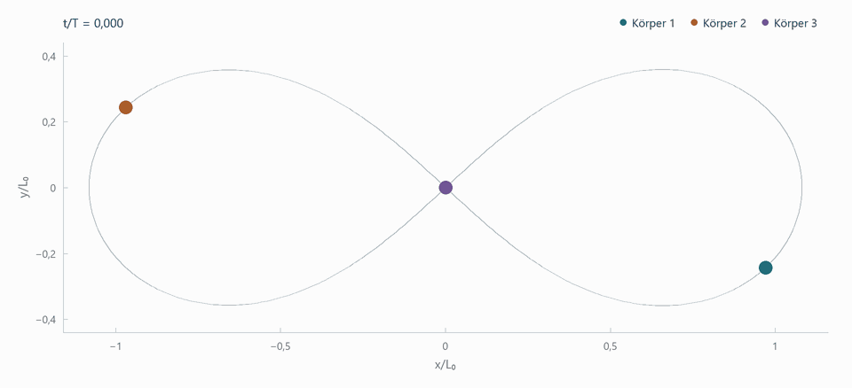
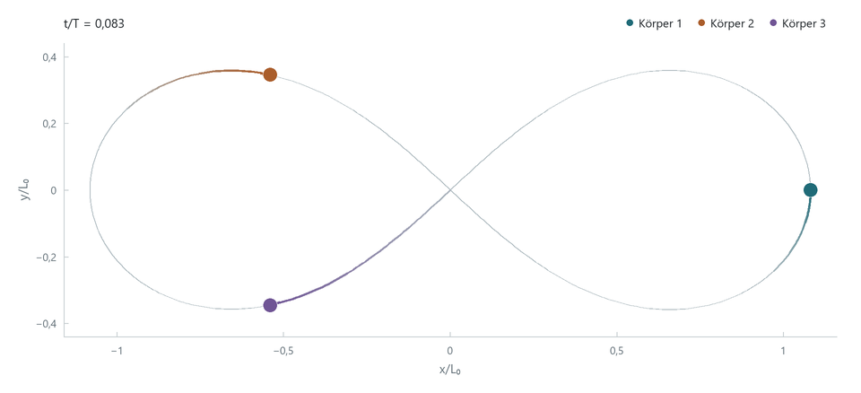

# Das Dreikörperproblem

Drei gleiche Massen laufen auf derselben Acht. Am Kreuzungspunkt kommt jede zu einer anderen Zeit vorbei. Hier lässt sich ein Umlauf anhalten und Bild für Bild untersuchen.



**[Interaktive Simulation herunterladen](https://github.com/chabane95/three-body-problem/raw/refs/heads/main/downloads/Dreikoerperproblem.zip)** · ZIP entpacken und `Dreikoerperproblem.html` öffnen. Die Animation läuft offline.

## Theorie

Für drei Punktmassen in einer Ebene gilt das Newtonsche Gravitationsgesetz

$$
\ddot{\mathbf r}_i =
G\sum_{j\ne i}m_j
\frac{\mathbf r_j-\mathbf r_i}{\lVert\mathbf r_j-\mathbf r_i\rVert^3}.
$$

In beiden Beispielen gilt $G=m_1=m_2=m_3=1$. Längen und Zeiten sind in Einheiten von $L_0$ und $t_0=\sqrt{L_0^3/(G_\mathrm{phys}M_0)}$ angegeben.

**Die Acht.** Nach einem Drittel der Periode erreicht jeder Körper den Startplatz seines Vorgängers. Für die Rechnung verwende ich die Anfangswerte von Carles Simó und die Periodenschätzung $T=6.32591398$ aus Abbildung 1 bei Chenciner und Montgomery. [Originalarbeit mit Anfangswerten](https://perso.imcce.fr/alain-chenciner/huit.pdf)

**Das Dreieck.** Drei Massen an den Ecken eines gleichseitigen Dreiecks der Seitenlänge 1 erfahren im Schwerpunktssystem die Beschleunigung $\ddot{\mathbf r}_i=-3\mathbf r_i$. Mit der passenden tangentialen Anfangsgeschwindigkeit rotieren sie auf einem Kreis mit Radius $1/\sqrt{3}$ und Winkelgeschwindigkeit $\sqrt{3}$. Diese exakte Lösung nutze ich, um den Integrator zu prüfen.

[](assets/trajectories.svg)

Das gleiche Kraftgesetz beschreibt auch Begegnungen dreier Sterne, bei denen ein Doppelstern zurückbleiben und der dritte Stern entkommen kann. Eine Anwendung des eingeschränkten Dreikörperproblems ist die Bewegung von Raumsonden nahe dem Sonne-Erde-Punkt L2. [Dreifachbegegnungen](https://www.nature.com/articles/s41586-019-1833-8) · [Webbs Umlaufbahn](https://esawebb.org/about/general/orbit/)

## Numerische Umsetzung

Der C++17-Kern berechnet jede Paarkraft einmal. Velocity-Verlet aktualisiert die Geschwindigkeiten um einen halben Zeitschritt, rückt alle Positionen vor und ergänzt mit den neuen Kräften die zweite Hälfte. Python wertet die gespeicherten Zustände aus. Für die Animation integriere ich **7 200 Schritte pro Umlauf** und speichere jeden zehnten. Bei engen Begegnungen muss die Schrittweite überprüft werden. Zusammenfallende Positionen bei einer Kraftauswertung lösen einen Abbruch aus. [Zum Verlet-Verfahren](https://www.math.mcgill.ca/gantumur/docs/down/gniverlet.pdf)

[](assets/diagnostics.svg)

**(a) Energie der Acht.** An den 721 gespeicherten Zeitpunkten beträgt die maximale relative Energieabweichung $4.55\times10^{-7}$. Nach einem Umlauf liegt jeder Körper höchstens $1.61\times10^{-6}$ Längeneinheiten von seinem Startpunkt entfernt. In diesen Rückkehrfehler geht auch die Rundung der publizierten Startwerte und der Periode ein.

**(b) Genauigkeit am Dreieck.** Über alle drei Körper und jeden Integrationsschritt gemessen sinkt der maximale Positionsfehler von $2.4054\times10^{-5}$ bei 1 440 Schritten auf $6.0136\times10^{-6}$ bei 2 880 Schritten. Der Faktor vier entspricht der erwarteten zweiten Ordnung.

| $t=0$ | $t=T/12$ | $t=T/4$ |
| --- | --- | --- |
|  |  |  |

Der kleinste gespeicherte Paarabstand auf der Acht beträgt 0,69052 Längeneinheiten. [Alle drei Paarabstände über der Zeit](assets/distances.svg)

<details>
<summary>Anfangswerte der Acht</summary>

| Körper | $(x,y)$ | $(v_x,v_y)$ |
| --- | --- | --- |
| 1 | $(0.97000436,-0.24308753)$ | $(0.466203685,0.432365730)$ |
| 2 | $(-0.97000436,0.24308753)$ | $(0.466203685,0.432365730)$ |
| 3 | $(0,0)$ | $(-0.932407370,-0.864731460)$ |

</details>

<details>
<summary>Selbst rechnen und die Abbildungen reproduzieren</summary>

Unter Windows mit PowerShell und `g++` aus dem Projektordner:

```powershell
New-Item -ItemType Directory -Force build | Out-Null
g++ -std=c++17 -O2 src/main.cpp -o build/three-body.exe
g++ -std=c++17 -O2 -Isrc tests/physics_test.cpp -o build/physics-test.exe
.\build\physics-test.exe
.\build\three-body.exe --scenario figure-eight --periods 1 --steps-per-period 7200 --sample-every 10
```

Unter Linux und macOS zuerst `mkdir -p build` ausführen und die beiden Programme ohne `.exe` bauen. Alternativ baut `cmake -S . -B build` gefolgt von `cmake --build build --config Release` beide Programme.

Die CLI schreibt JSON auf die Standardausgabe. `--scenario lagrange` wählt das Dreieck. Eigene Positionen, Geschwindigkeiten und positive Massen lassen sich als `three_body::State` an `simulate` übergeben. [C++-Schnittstelle](src/physics.hpp)

Mit Python ab 3.10 lassen sich alle mitgelieferten Daten und Medien neu erzeugen.

```bash
python scripts/prepare.py
python -m pip install -r requirements-render.txt
python scripts/render.py
python scripts/bundle_viewer.py
```

Bei einem CMake-Build mit Visual Studio den Solver mit `--solver build/Release/three-body.exe` an `prepare.py` übergeben. Die Datensätze liegen in `data/`, die Abbildungen in `assets/` und die fertige Offline-Seite in `dist/`.

</details>

[GPT-Prompt für dieses Projekt](PROMPT.md)
